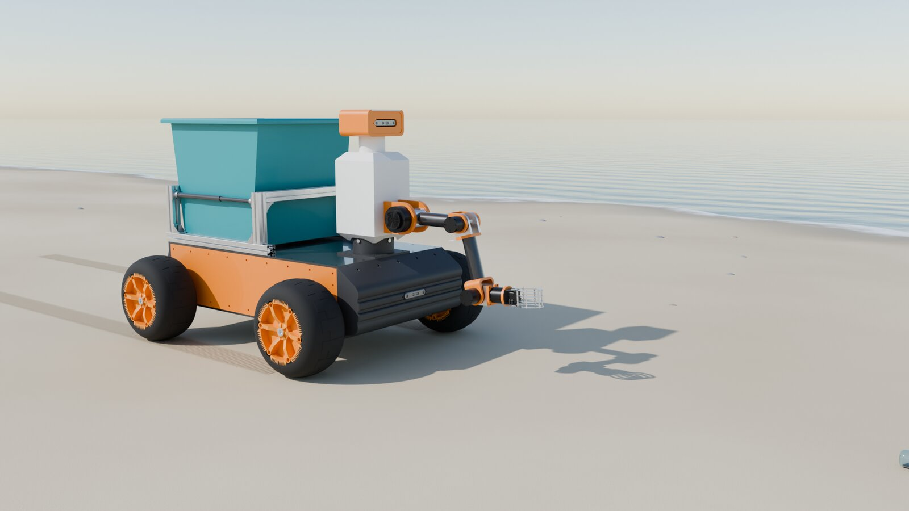
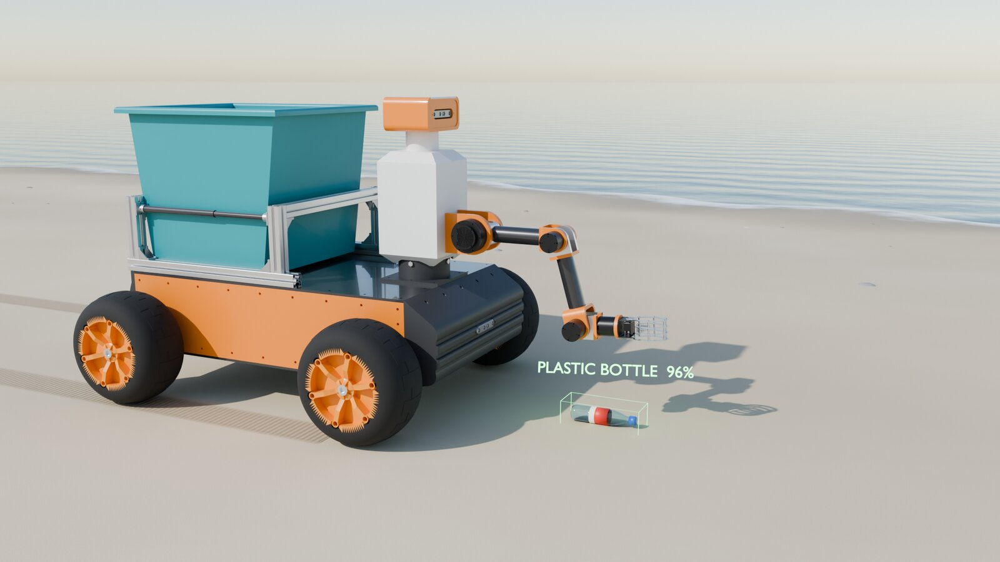
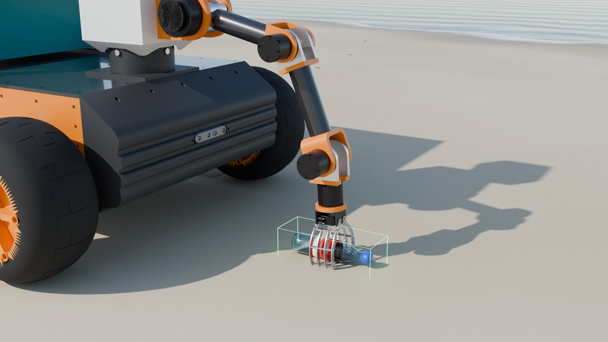
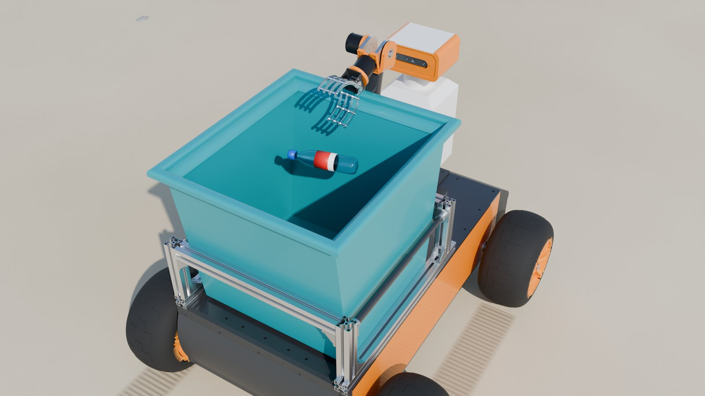
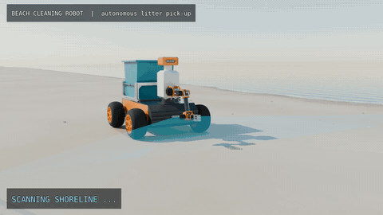

# Beach-Cleaning Mobile Manipulator

A four-wheel mobile robot with an on-board robotic arm that patrols a beach, finds litter and drops it into its own collection bin. I designed the full robot in SolidWorks and produced a rendered animation of the pick-up cycle for the client.

  
  

  
  

## Animation

The robot scans the shoreline, stops at a detected plastic bottle, picks it up with the arm, drops it in the bin and resumes its patrol. Click the preview for the full MP4.

## Design

| Item | Detail |
|---|---|
| Base | Four-wheel drive platform with wide, low-pressure wheels for sand |
| Manipulator | Multi-joint arm with a gripper, mounted at the front corner of the chassis |
| Storage | Top-mounted collection bin on an aluminium-extrusion frame |
| Sensing | Camera and electronics enclosure on a mast behind the arm |
| Operation | Patrol, detect, stop, pick, deposit, resume |
| Tools | SolidWorks (design), rendering and animation of the full cycle |

## Process

1. Defined the task cycle with the client: patrol the beach, detect litter, pick it up and store it on board.
2. Laid out the mobile base, arm reach and bin position so the arm can reach the ground and the bin from one mount.
3. Modelled the chassis, wheels, frame, bin and arm in SolidWorks.
4. Rendered stills and an animation of the full pick-up cycle for the client presentation.

---

**Full project files are private.** The CAD files and the full-resolution animation are in a private repository. Access is available upon request: see [Request access](../README.md#request-access).

[Back to the portfolio](../README.md)
