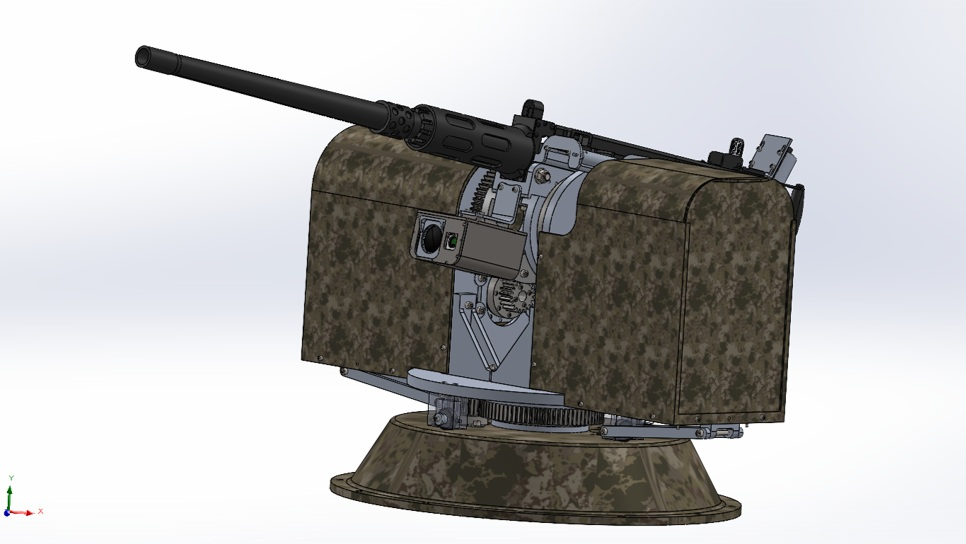
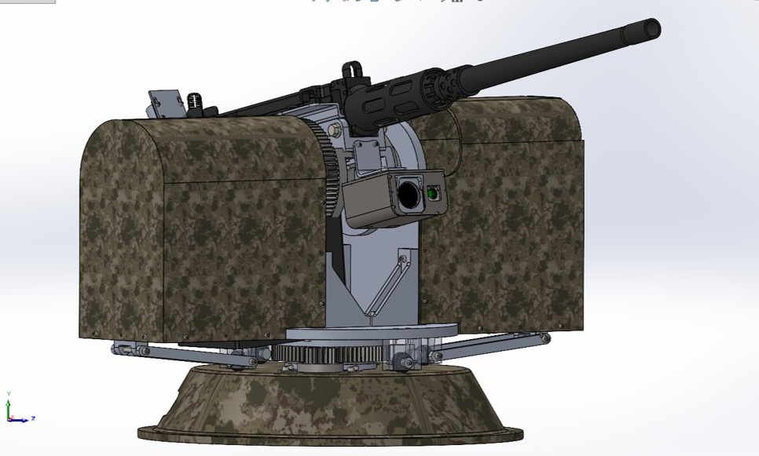
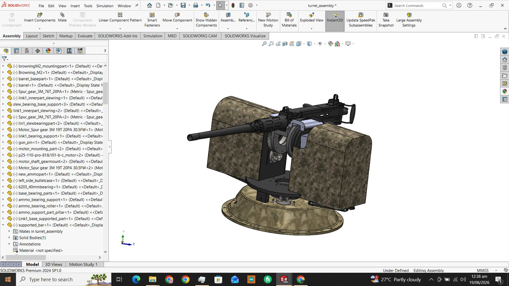
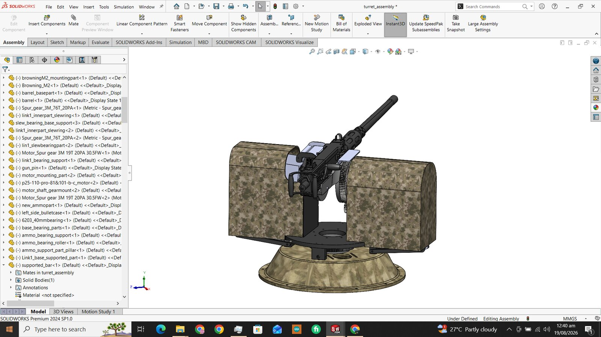
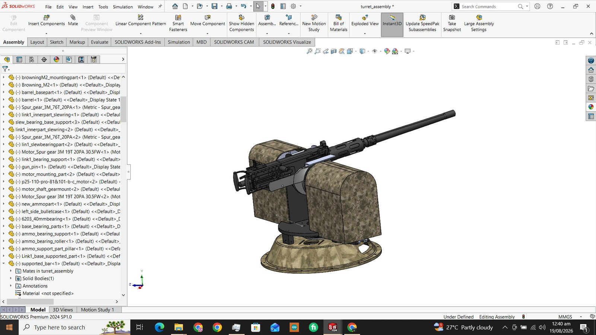
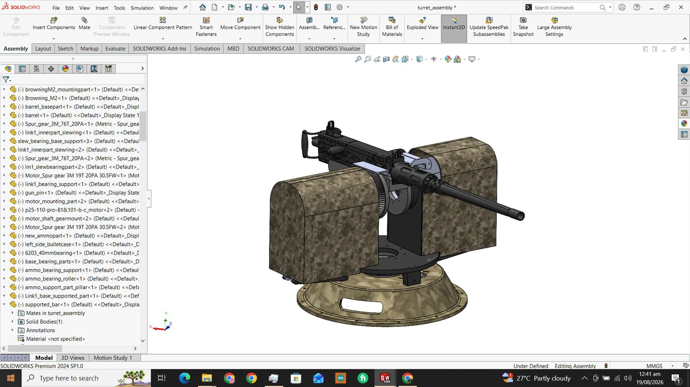
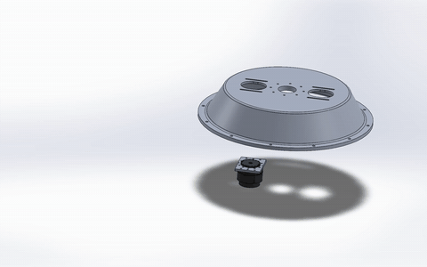
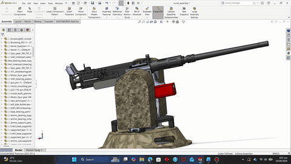

# Heavy Two-Axis Turret Mount (M2 platform)

Mechanical design of a heavy-duty two-axis (pan/tilt) turret mount sized for an M2-class payload. The pan stage runs on a slewing bearing driven through a spur-gear reduction. A second motor and gear stage drive the elevation axis. Side enclosures house the payload supports. The package includes an assembly-sequence animation set and a full bill of materials with sourcing.

  
  

  
  
  
  

## Assembly animations

| Base motor mounting | Base + link 1 | Link 1 motor assembly | Assembly part 1 |
|---|---|---|---|
|  |  |  |  |

Full model walkaround:

Click a preview to open the full MP4.

---

**Full project files are private.** The STEP assembly, BOMs, fastener schedule, assembly document and slewing bearing specification are in a private repository. Access is available upon request: see [Request access](../README.md#request-access).

[Back to the portfolio](../README.md)
