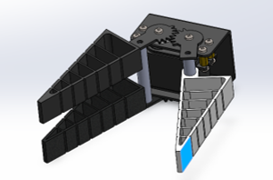
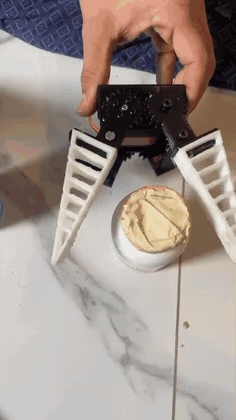

# Fin Ray Effect Adaptive Gripper

A servo-driven two-finger gripper with compliant **Fin Ray** fingers. Two meshed spur gears drive the fingers symmetrically. Under load the ribbed finger structure bends around the object instead of away from it, so the gripper holds soft and irregular objects without force control.

  

## Demo

The printed prototype conforming to different objects. Click the preview for the full MP4.

## Design points

- 3D-printed Fin Ray fingers with cross ribs
- Gear-synchronised finger motion from a single servo

---

**Full project files are private.** The CAD files and the full demo video are in a private repository. Access is available upon request: see [Request access](../README.md#request-access).

[Back to the portfolio](../README.md)
