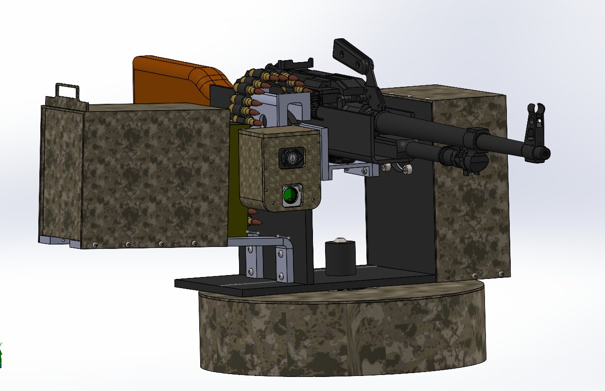
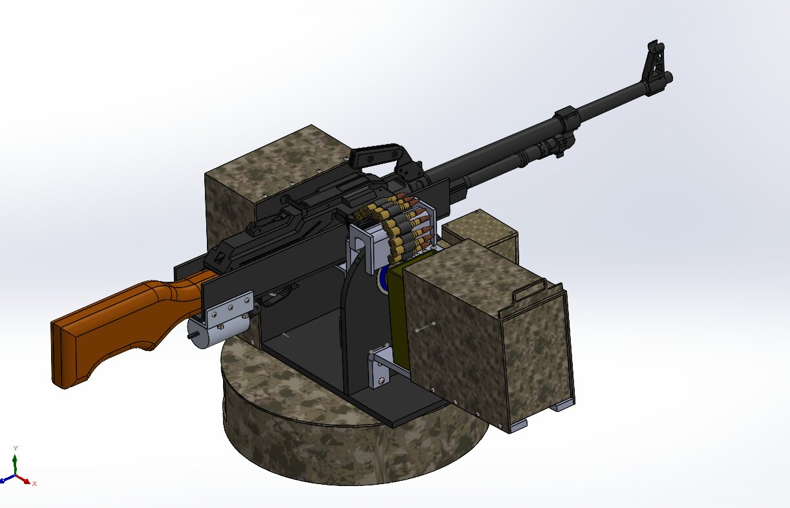
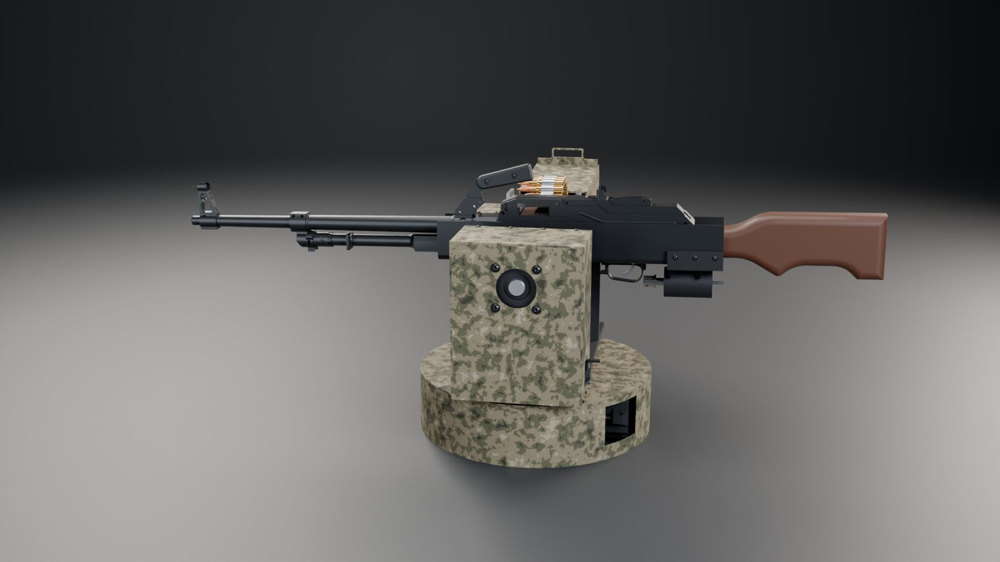
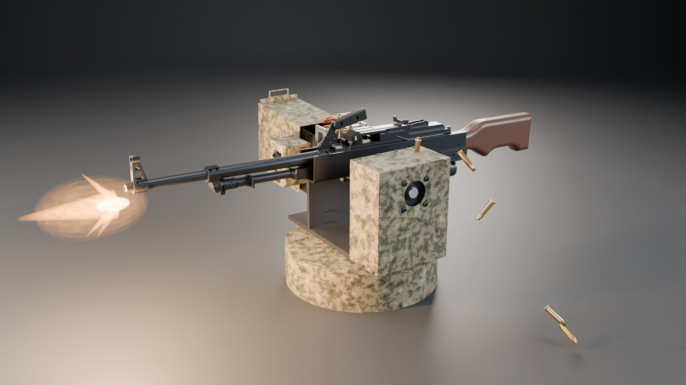
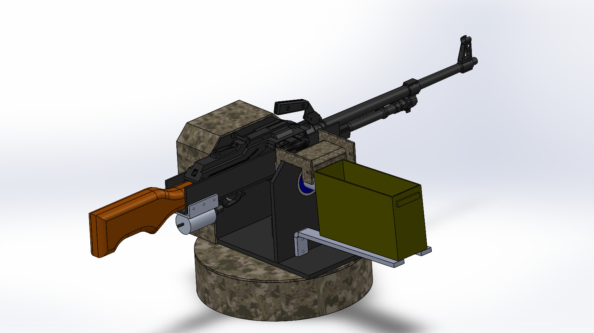
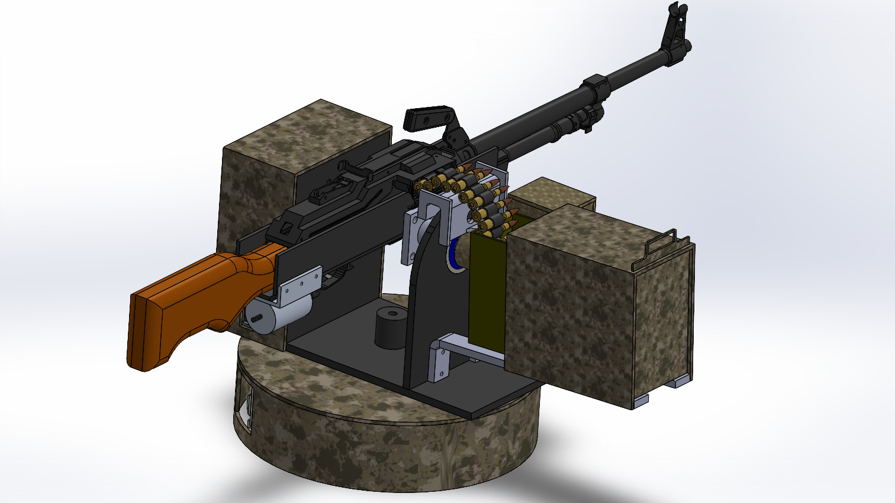
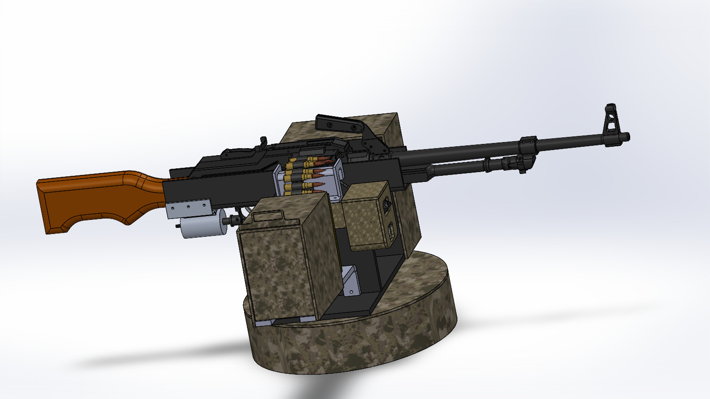
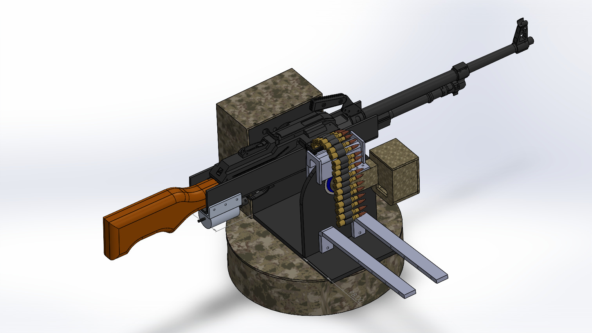

# Two-Axis Turret Mount (PKM platform)

Complete mechanical design package for a two-axis (pan/tilt) turret mount sized for a PKM-class payload. The drive train uses a NEMA 34 geared motor, 35x70 bearings and custom shafts and couplings for the pan and elevation axes. The mount also carries a camera and laser-sensor housing and ammunition-box supports. The package is manufacturing-ready: native CAD, 2D drawings for machined parts, STL files for printed parts, and a screw BOM.

  
  

  
  

  
  
  
  

See also: [the UGV that carries this turret mount](../UGV_PKM_Robot).

---

**Full project files are private.** The native SolidWorks files, STEP assembly, 2D drawings, STL files and screw BOM are in a private repository. Access is available upon request: see [Request access](../README.md#request-access).

[Back to the portfolio](../README.md)
