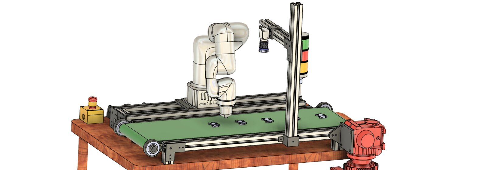

# Vision-Guided Pick-and-Place Workcell

Concept design of a robotic pick-and-place cell. A collaborative arm picks parts from a belt conveyor. An overhead camera on an aluminium-extrusion gantry detects the parts. A stack light and an emergency stop handle cell status and safety.

  

## Cell layout

- Belt conveyor on an aluminium-extrusion frame, driven by a geared motor
- 6-axis collaborative arm mounted on the conveyor frame
- Overhead machine-vision camera on an extrusion mast
- Three-colour stack light and emergency stop button

---

**Full project files are private.** The CAD files are in a private repository. Access is available upon request: see [Request access](../README.md#request-access).

[Back to the portfolio](../README.md)
