# Robotics Portfolio: Fazal E Haq

**Robotics Design & Control Systems Engineer** · Islamabad, Pakistan

## Featured Research: MS Thesis

**Design and Control of a Modular and Flexible 7-DOF Robotic Manipulator** 
MS Electrical Engineering (Control Systems), SEECS, National University of Sciences and Technology (NUST), Islamabad, 2026 
Supervisor: Dr. Latif Anjum · Co-supervisor: Dr. Usman Ali · DAAD funded the actuators, power supply and workstation

<table>
<tr>
<td width="33%" align="center">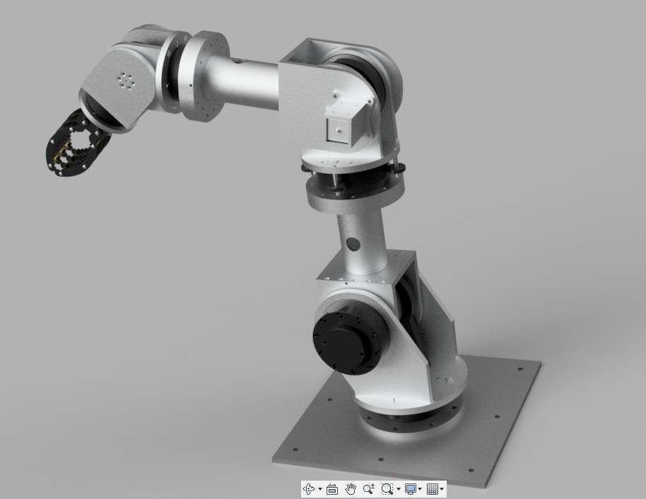 7-DOF build, SolidWorks render</td>
<td width="33%" align="center">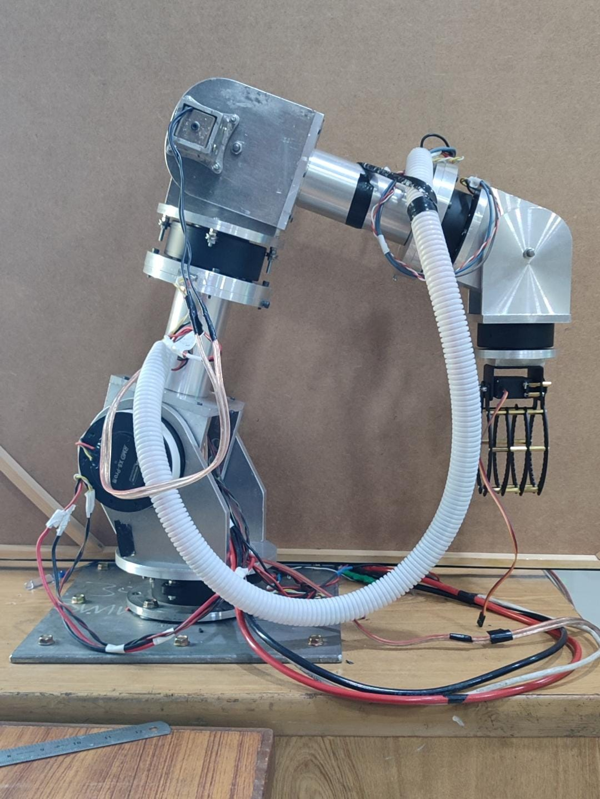 Upright build on the lab bench</td>
<td width="33%" align="center">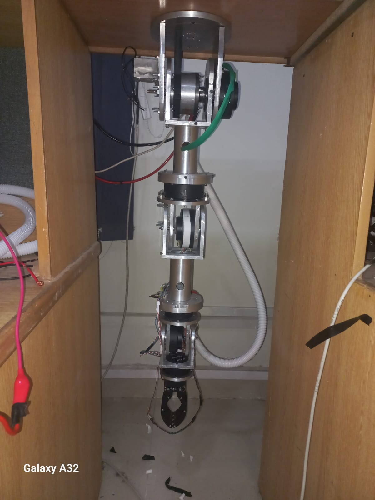 Inverted 6-DOF build under a workbench</td>
</tr>
</table>

### Objective

Design and build, from scratch, one research platform that a university lab can reconfigure from a 7-DOF arm down to a 3-DOF arm. Students can learn control on a simple build and then scale up to the full 7-DOF arm with the same hardware.

### Design process

1. **Requirements and actuator limits.** The actuators arrived before the design existed, so I sized the link lengths and mass around their torque limits.
2. **CAD design.** I modelled the joint modules and aluminium extension rods in SolidWorks, so one module set assembles into several arms.
3. **Torque budget.** I built a gravity-aware torque budget from the CAD mass properties. The first prototype could not hold its own weight, so I shortened the links and added a 10:1 planetary gearbox at the shoulder.
4. **Fabrication.** I compared CNC, lathe and 3D printing, chose lathe-turned aluminium parts and released the drawings to the workshop.
5. **Electronics.** A 48 V supply and a CAN bus split across two controllers run the control loop at 100 Hz.
6. **Simulation.** I built URDF models of every build and tested them in CoppeliaSim and PyBullet before running the hardware.
7. **Assembly and commissioning.** I assembled the arm, tuned each joint drive and commissioned the builds step by step on the bench.

### Techniques applied

Forward and inverse kinematics · Jacobian and manipulability analysis · workspace analysis · rigid-body dynamics · computed torque control with PID and friction compensation · trajectory generation · simulation-to-hardware comparison

### Outcome

- One module set builds **eight arms from 3 to 7 DOF**, including an inverted arm mounted under a workbench.
- The 7-DOF build weighs 20.8 kg and reaches 0.85 m.
- One set of controller gains works on every build without retuning in simulation.
- Computed torque control runs on the hardware; gain tuning is in progress.
- Hardware and fabrication cost PKR 111,400, of which PKR 100,000 came from the MS research grant.

<table>
<tr>
<td width="40%" align="center">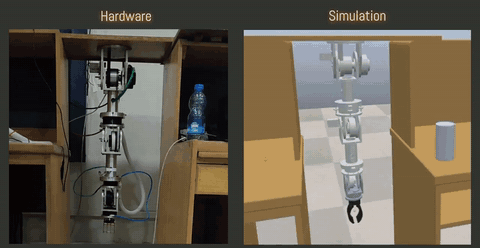 Hardware and CoppeliaSim model reach the same waypoints</td>
<td width="20%" align="center">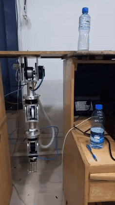 Pick-and-place on the inverted build</td>
<td width="40%" align="center">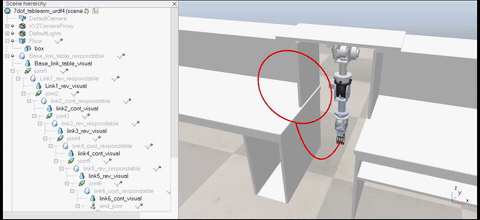 Circular trajectory under torque control in simulation</td>
</tr>
</table>

### Next steps

Finish gain tuning of the torque controller on hardware, identify joint friction on the assembled arm, and apply redundancy resolution to the 7-DOF build. The arm is in the ROMI Lab, NUST. The full thesis is available on request.

**[Open the thesis project folder](Robotic_Arm_7DOF_Thesis)** for more photos and videos.

---

## Portfolio

Mechanical design and robot modelling in **SolidWorks**, with **URDF / ROS** exports, simulation and built hardware. The projects below span serial arms from 3 to 7 DOF, adaptive grippers, mobile robots, heavy two-axis mounts and an automation cell. Each project has its own folder with images, videos and a description: click a card to open it.

> **Full project files are private.** Native SolidWorks and STEP models, URDF packages, 2D drawings, BOMs and full-length videos for every project are kept in a private repository. **Access is available upon request** (see [Request access](#request-access)).

**Skills shown:** SolidWorks part/assembly design · design for 3D printing and machining · URDF export and ROS packages (RViz, Gazebo) · mass properties and joint torque sizing · SolidWorks Simulation (FEA) · 2D manufacturing drawings · BOMs and fastener schedules · assembly animations · hardware prototyping and trajectory control

## Highlights

<table>
<tr>
<td width="50%" align="center"> 7-DOF arm: hardware and simulation running side by side</td>
<td width="50%" align="center">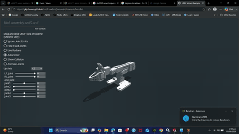 5-DOF extrusion-link arm: URDF joint test</td>
</tr>
<tr>
<td align="center">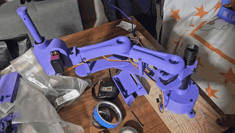 3-DOF SCARA: printed and assembled prototype</td>
<td align="center">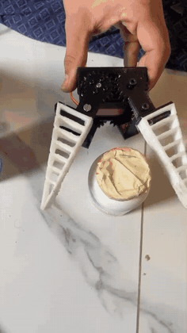 Fin Ray gripper conforming to objects</td>
</tr>
<tr>
<td align="center">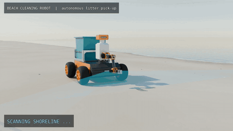 Beach-cleaning robot: detect, pick and store litter</td>
<td align="center">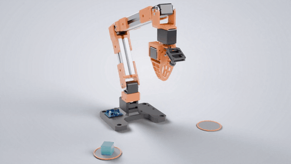 5-DOF arm: pick-and-place animation</td>
</tr>
</table>

## Projects

<table>
<tr>
<td width="33%" align="center" valign="top"><a href="Robotic_Arm_7DOF_Thesis">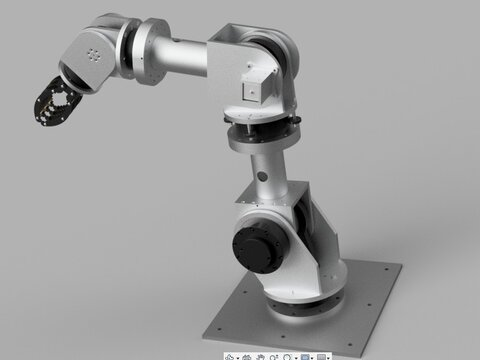</a> <b><a href="Robotic_Arm_7DOF_Thesis">7-DOF Modular Manipulator (MS Thesis)</a></b> Designed from scratch; one module set reconfigures from 7 DOF to 3 DOF; 20.8 kg aluminium arm running computed torque control</td>
<td width="33%" align="center" valign="top"><a href="SO_ARM_5DOF_Modified">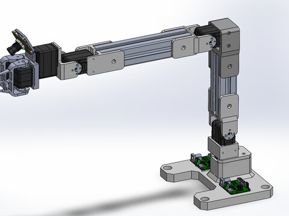</a> <b><a href="SO_ARM_5DOF_Modified">5-DOF Extrusion-Link Arm (Modified SO-ARM)</a></b> 30 × 30 mm aluminium extrusion links, FEETECH bus servos, 400 g payload target, renders, pick-and-place animation, URDF</td>
<td width="33%" align="center" valign="top"><a href="Robotic_Arm_6DOF_Hobby_Servo">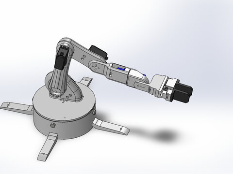</a> <b><a href="Robotic_Arm_6DOF_Hobby_Servo">6-DOF Low-Cost Servo Arm</a></b> MG996R / SG90 servos, rack-and-pinion gripper, 422.9 mm reach, joint torque budget, URDF</td>
</tr>
<tr>
<td align="center" valign="top"><a href="Scara_Robotic_Manipulator_3DOF">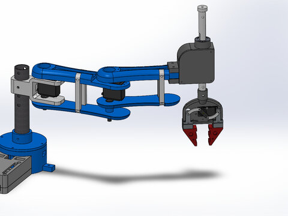</a> <b><a href="Scara_Robotic_Manipulator_3DOF">3-DOF SCARA Manipulator</a></b> 3D-printed SCARA with rack-and-pinion Z axis; FEA-checked brackets; fabricated and assembled with no redesign</td>
<td align="center" valign="top"><a href="Finray_Effect_Gripper">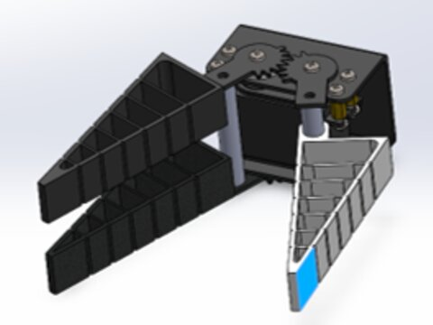</a> <b><a href="Finray_Effect_Gripper">Fin Ray Effect Adaptive Gripper</a></b> Compliant fingers, single servo with gear-synchronised motion, printed and tested on hardware</td>
<td align="center" valign="top"><a href="So_arm_101_Modified_urdf">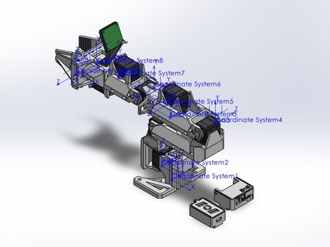</a> <b><a href="So_arm_101_Modified_urdf">SO-ARM 101 Modified: URDF Generation</a></b> SolidWorks remodel of the follower arm, link frames and joint limits, exported and validated URDF</td>
</tr>
<tr>
<td align="center" valign="top"><a href="Beach_Cleaning_Mobile_Manipulator">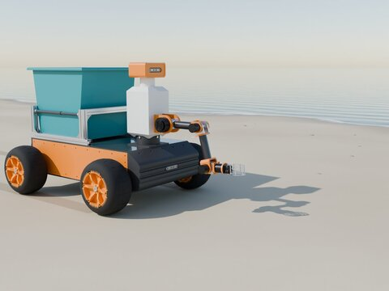</a> <b><a href="Beach_Cleaning_Mobile_Manipulator">Beach-Cleaning Mobile Manipulator</a></b> Four-wheel robot with an arm and on-board bin that picks up litter on patrol; rendered animation</td>
<td align="center" valign="top"><a href="UGV_PKM_Robot">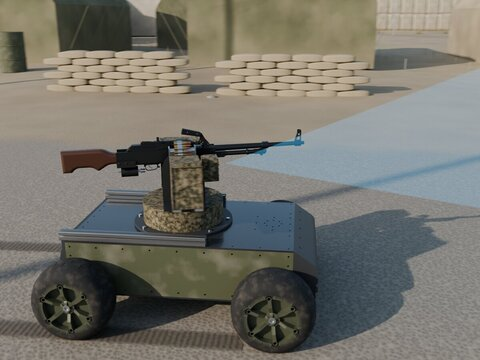</a> <b><a href="UGV_PKM_Robot">UGV with Two-Axis Turret Mount</a></b> PKM pan/tilt mount integrated on a four-wheel UGV; concept animation</td>
<td align="center" valign="top"><a href="BrowningM2_Turret_Mount">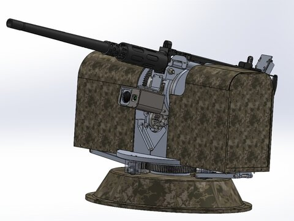</a> <b><a href="BrowningM2_Turret_Mount">Heavy Two-Axis Turret Mount</a></b> Slewing-bearing traverse with spur-gear reduction; BOM, fastener schedule, bearing spec and assembly animations</td>
</tr>
<tr>
<td align="center" valign="top"><a href="PKM_Turret_Mount">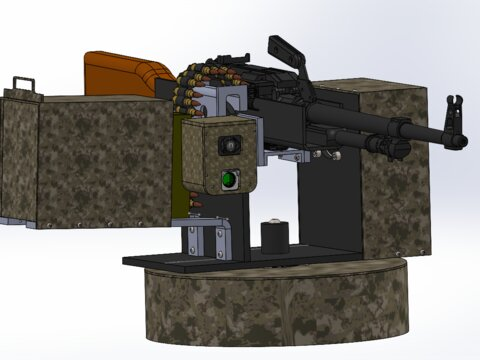</a> <b><a href="PKM_Turret_Mount">Two-Axis Turret Mount: Manufacturing Package</a></b> NEMA 34 geared drive; 43 parts, 19 manufacturing drawings, 27 printable STL parts, screw BOM</td>
<td align="center" valign="top"><a href="Pick_and_Place_Workcell">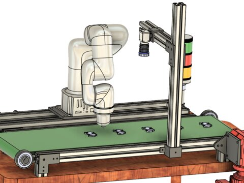</a> <b><a href="Pick_and_Place_Workcell">Vision-Guided Pick-and-Place Cell</a></b> Cobot, belt conveyor and overhead camera mast on an aluminium-extrusion frame</td>
<td></td>
</tr>
</table>

## What each private project folder contains

| Folder | Content |
|---|---|
| `media/` | Renders, photos, full-length MP4 videos |
| `cad/` | STEP assembly and native SolidWorks parts and assemblies |
| `urdf/` | ROS description package: URDF, meshes, RViz and Gazebo launch files |
| `drawings/` | 2D manufacturing drawings (PDF + SLDDRW) |
| `stl/` | Print-ready STL files |
| `docs/` | BOMs, fastener schedules, specifications |

## Request access

To review the full CAD, URDF and drawing files for any project, contact me with your **GitHub username** and I will add you to the private repository.

- **Email:** [fhaq.msee23seecs@seecs.edu.pk](mailto:fhaq.msee23seecs@seecs.edu.pk)
- **OR:**[fhengineer68@gmail.com](mailto:fhengineer68@gmail.com)
- **LinkedIn:** [Fazal E Haq](http://www.linkedin.com/in/fazal-e-haq-84b2b821b/)
- **Fiverr:** [fiverr.com/fazalehaq_123](https://www.fiverr.com/fazalehaq_123)
