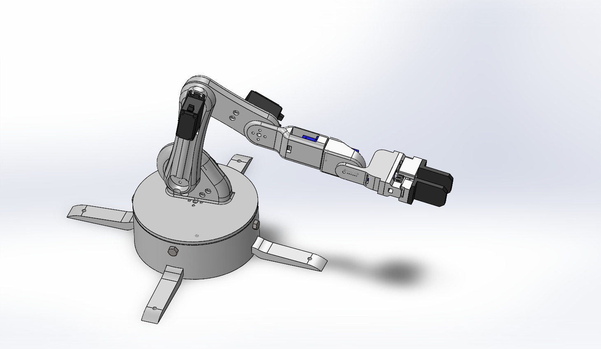
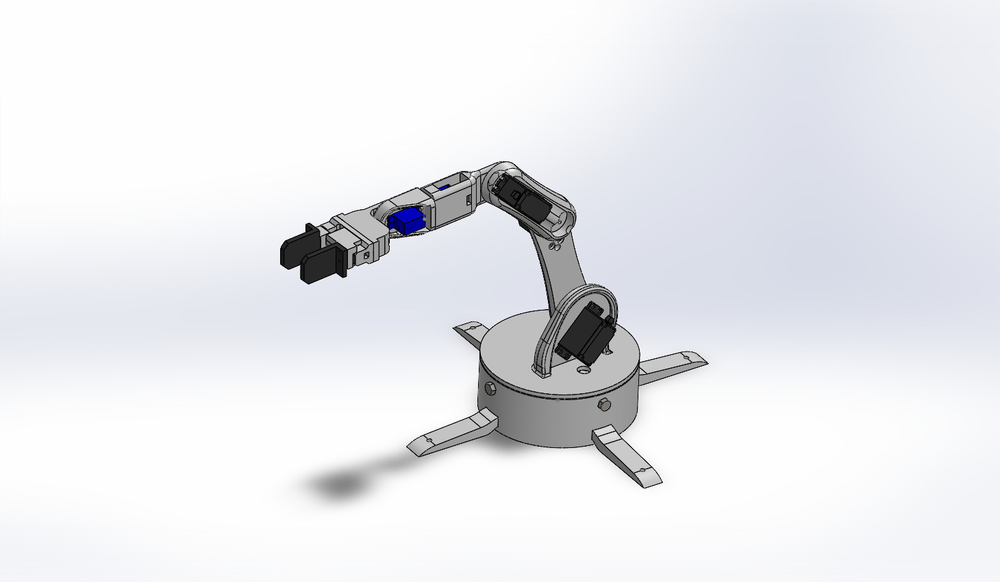
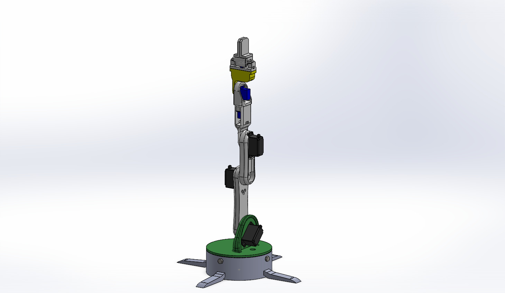
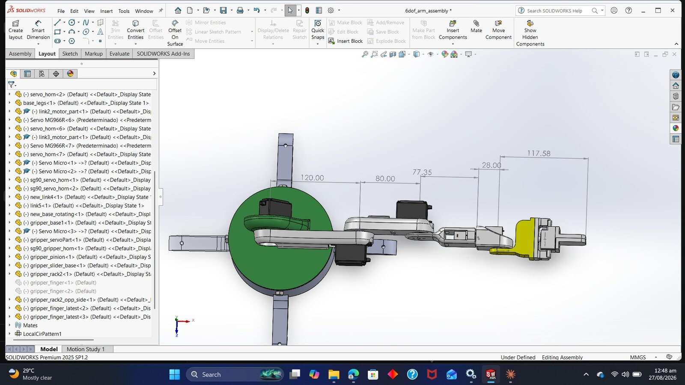
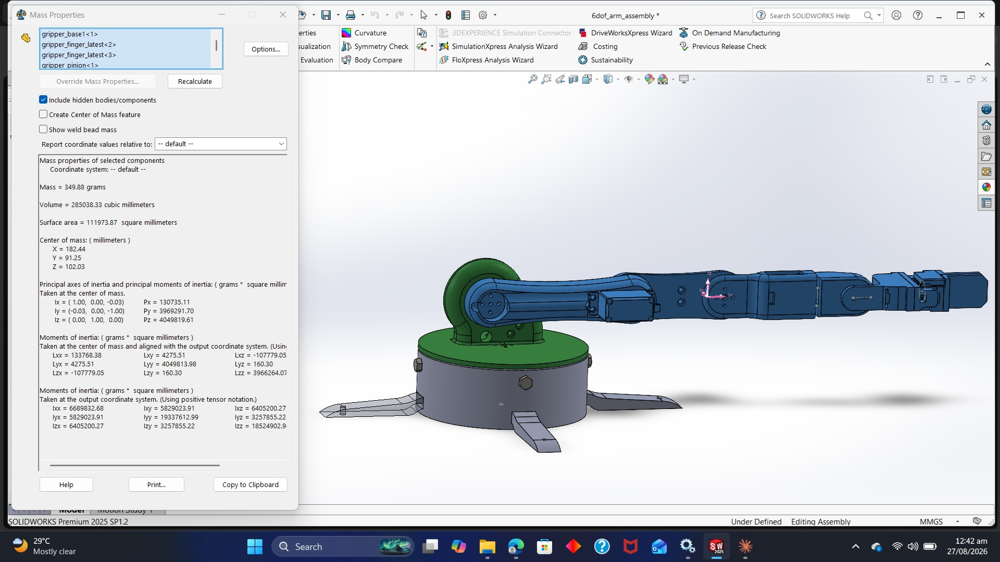
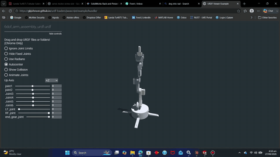

# 6-DOF Hobby-Servo Robotic Arm with Rack-and-Pinion Gripper

A low-cost 6-DOF desktop arm built around MG996R and SG90 hobby servos. The base rotates on a 608-bearing turntable, and the arm ends in a rack-and-pinion parallel gripper. The design includes mass properties, a joint torque budget and a full URDF package.

  
  
  

## Highlights

| Item | Detail |
|---|---|
| Degrees of freedom | 6 revolute joints + parallel gripper |
| Actuators | 4x MG996R (base, link1, link2, link3), 3x SG90 (link4, link5, gripper) |
| Base | Turntable on 4x 608 bearings (M8 axles) |
| Gripper | Rack-and-pinion, prismatic fingers |
| Link lengths | 120 / 80 / 77.35 / 28 / 117.58 mm (joint to joint) |
| Reach from shoulder | 422.9 mm |
| Moving arm mass | 349.9 g (SolidWorks mass properties) |
| CAD | SolidWorks Premium 2025, exported to STEP |
| Simulation | URDF + meshes, RViz and Gazebo launch files |

## Design analysis

| Link lengths | Mass properties |
|---|---|
|  |  |

A joint torque budget built from these mass properties identifies the shoulder as the critical joint for servo sizing.

## Video

URDF loaded in a web viewer with all joints driven through their limits. Click the preview for the full MP4.

---

**Full project files are private.** The STEP assembly, URDF/ROS package, torque budget and BOM are in a private repository. Access is available upon request: see [Request access](../README.md#request-access).

[Back to the portfolio](../README.md)
