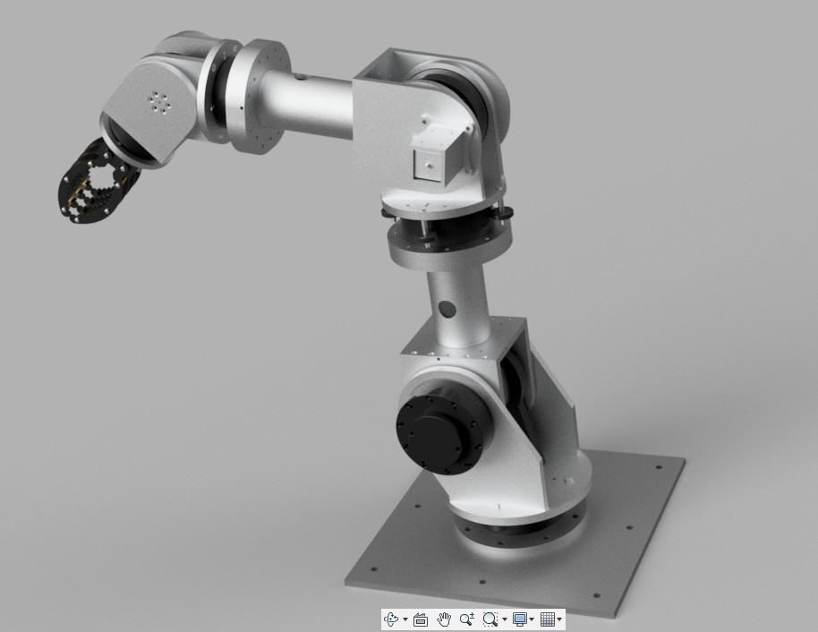
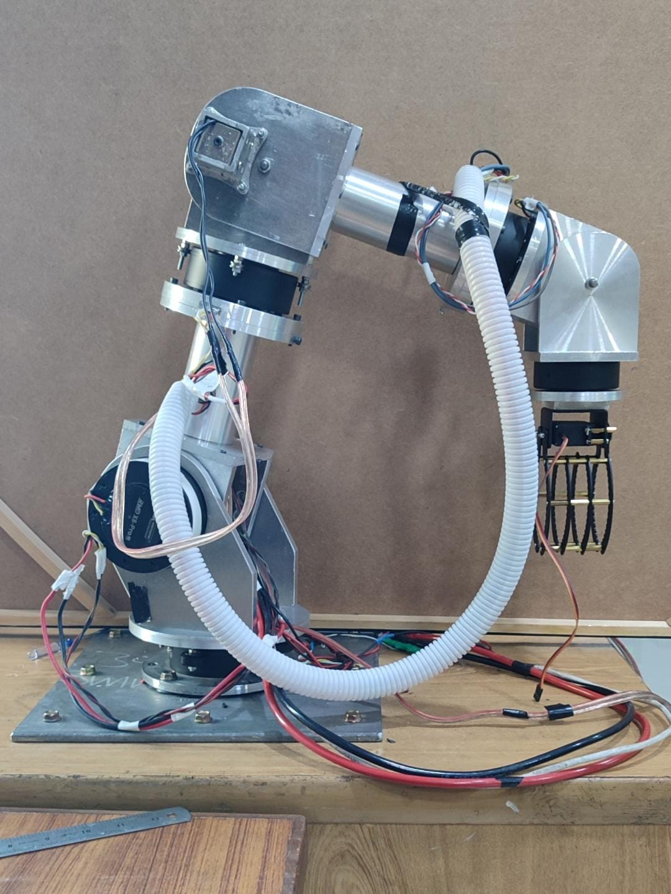
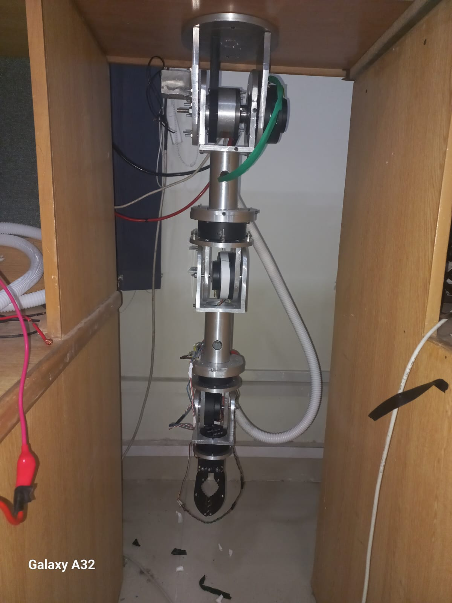
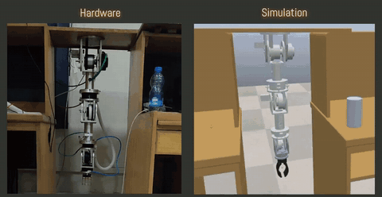
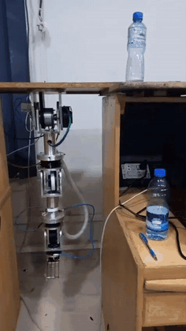
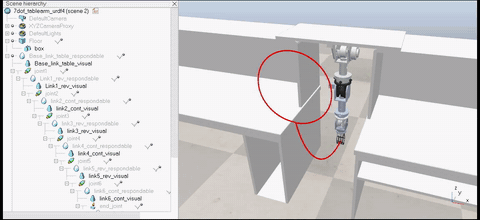
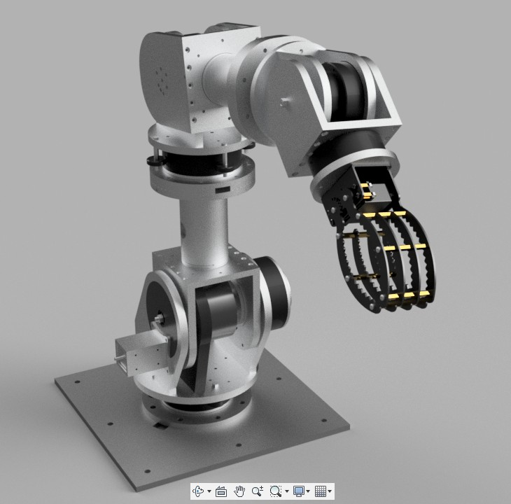
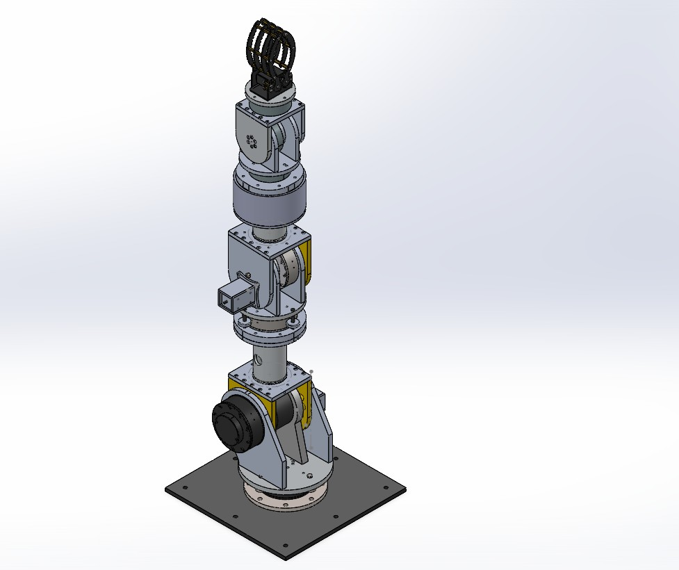
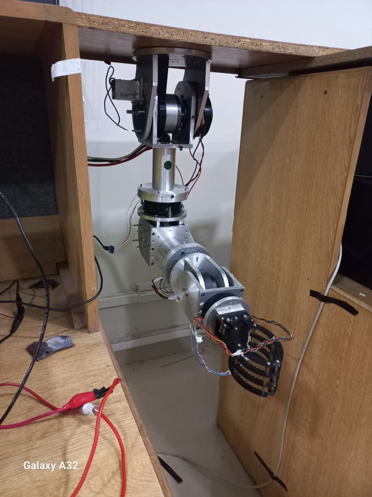

# 7-DOF Modular Robotic Manipulator (MS Thesis)

**Design and Control of a Modular and Flexible 7-DOF Robotic Manipulator** 
MS Electrical Engineering (Control Systems), SEECS, National University of Sciences and Technology (NUST), Islamabad, 2026 
Supervisor: Dr. Latif Anjum · Co-supervisor: Dr. Usman Ali · DAAD funded the actuators, power supply and workstation

<table>
<tr>
<td width="33%" align="center"> 7-DOF build, SolidWorks render</td>
<td width="33%" align="center"> Upright build on the lab bench</td>
<td width="33%" align="center"> Inverted 6-DOF build under a workbench</td>
</tr>
</table>

## Objective

Design and build, from scratch, one research platform that a university lab can reconfigure from a 7-DOF arm down to a 3-DOF arm. Students can learn control on a simple build and then scale up to the full 7-DOF arm with the same hardware.

## Design process

1. **Requirements and actuator limits.** The actuators arrived before the design existed, so I sized the link lengths and mass around their torque limits.
2. **CAD design.** I modelled the joint modules and aluminium extension rods in SolidWorks, so one module set assembles into several arms.
3. **Torque budget.** I built a gravity-aware torque budget from the CAD mass properties. The first prototype could not hold its own weight, so I shortened the links and added a 10:1 planetary gearbox at the shoulder.
4. **Fabrication.** I compared CNC, lathe and 3D printing, chose lathe-turned aluminium parts and released the drawings to the workshop.
5. **Electronics.** A 48 V supply and a CAN bus split across two controllers run the control loop at 100 Hz.
6. **Simulation.** I built URDF models of every build and tested them in CoppeliaSim and PyBullet before running the hardware.
7. **Assembly and commissioning.** I assembled the arm, tuned each joint drive and commissioned the builds step by step on the bench.

## Techniques applied

Forward and inverse kinematics · Jacobian and manipulability analysis · workspace analysis · rigid-body dynamics · computed torque control with PID and friction compensation · trajectory generation · simulation-to-hardware comparison

## Outcome

- One module set builds **eight arms from 3 to 7 DOF**, including an inverted arm mounted under a workbench.
- The 7-DOF build weighs 20.8 kg and reaches 0.85 m.
- One set of controller gains works on every build without retuning in simulation.
- Computed torque control runs on the hardware; gain tuning is in progress.
- Hardware and fabrication cost PKR 111,400, of which PKR 100,000 came from the MS research grant.

<table>
<tr>
<td width="40%" align="center"> Hardware and CoppeliaSim model reach the same waypoints</td>
<td width="20%" align="center"> Pick-and-place on the inverted build</td>
<td width="40%" align="center"> Circular trajectory under torque control in simulation</td>
</tr>
</table>

## More photos

  
  
  

Click a video preview above to open the full MP4.

## Next steps

Finish gain tuning of the torque controller on hardware, identify joint friction on the assembled arm, and apply redundancy resolution to the 7-DOF build. The arm is in the ROMI Lab, NUST. The full thesis is available on request.

---

**Full project files are private.** The full thesis, SolidWorks models and full-length videos are in a private repository. Access is available upon request: see [Request access](../README.md#request-access).

[Back to the portfolio](../README.md)
