# SO-ARM 5-DOF Modified: Extrusion-Link Robotic Arm

A redesigned 5-DOF version of the SO-ARM desktop manipulator. The printed links of the original are replaced with 30x30 aluminium extrusion, and the arm runs on FEETECH serial bus servos. The design targets a **400 g payload** and ships with a SolidWorks-exported **URDF / ROS package** for simulation.

  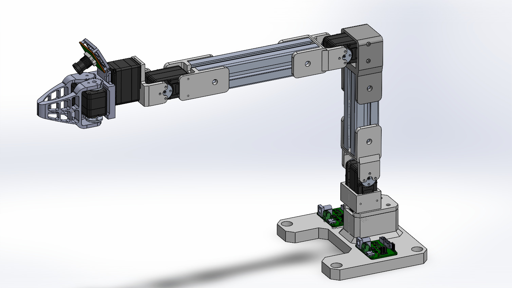
  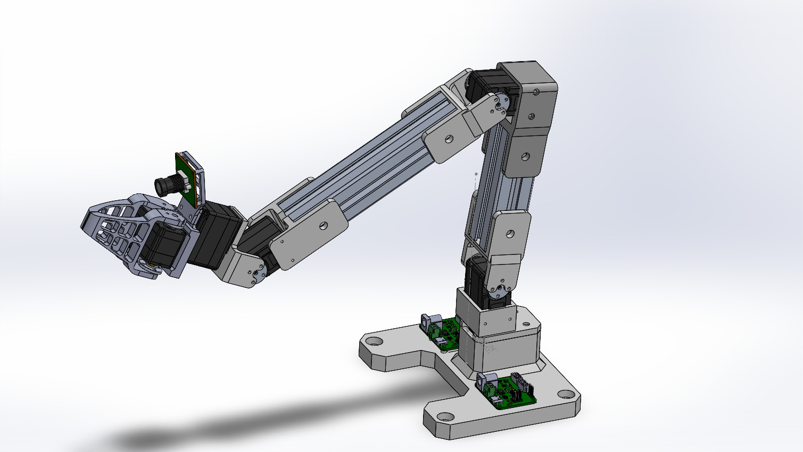

  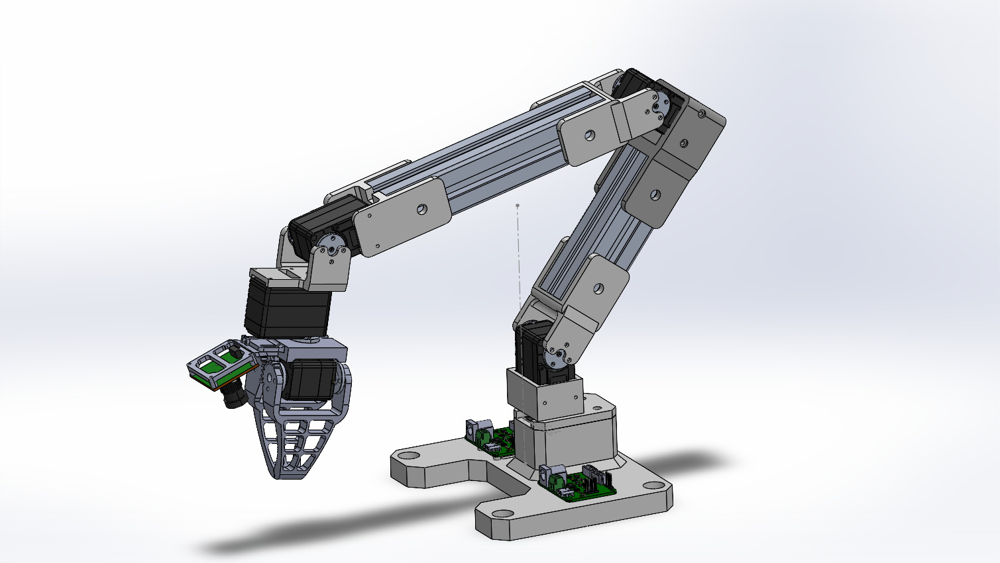
  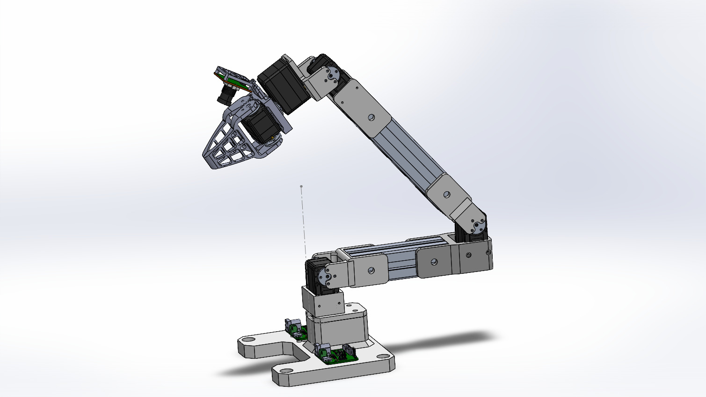

## Renders

  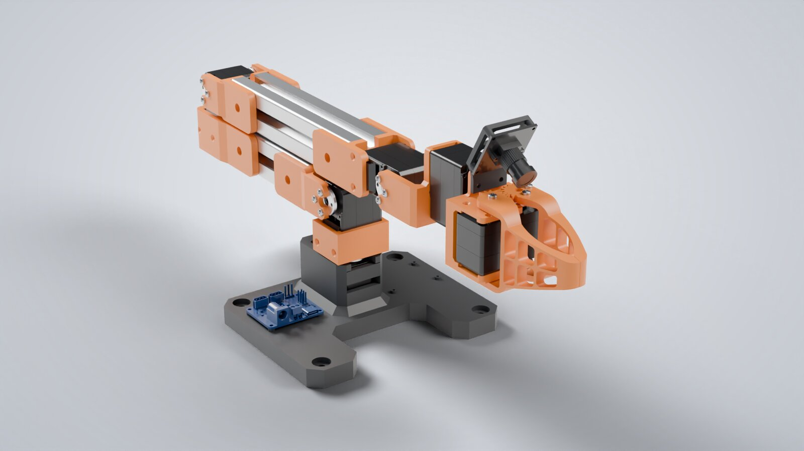
  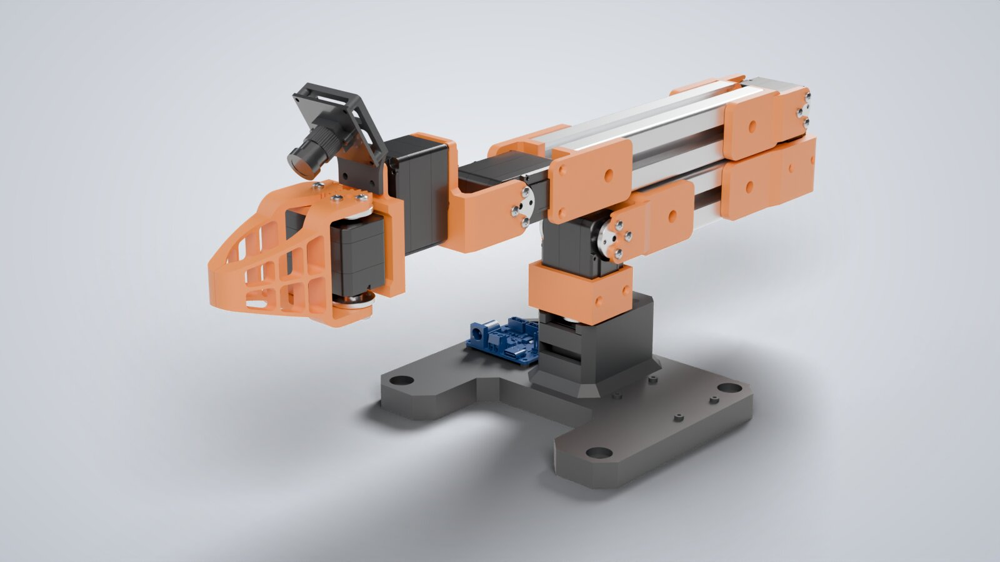

  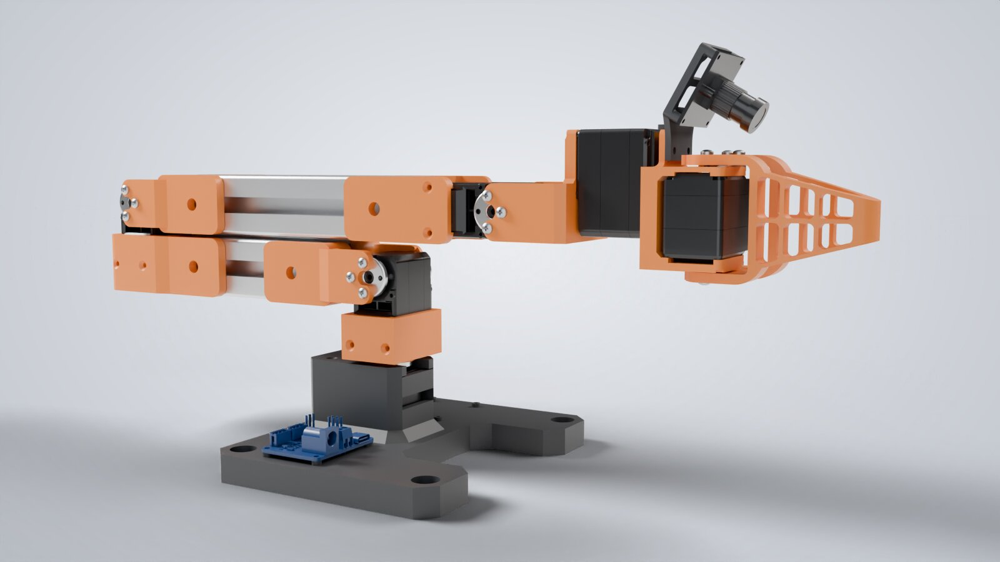
  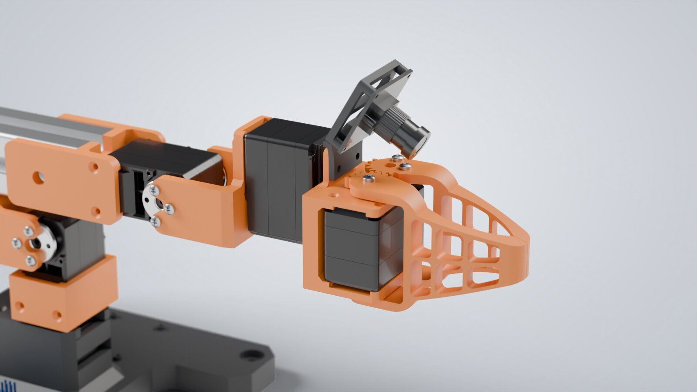

## Highlights

| Item | Detail |
|---|---|
| Degrees of freedom | 5 revolute joints + 2-finger gripper |
| Links | 30x30 aluminium extrusion with bolted joint brackets |
| Actuators | FEETECH STS3250 (50 kg.cm) at shoulder and elbow; STS3215 at base, wrist and gripper |
| Payload target | 400 g |
| Sensing | Wrist-mounted camera module on the end effector |
| Model mass (URDF) | approx. 2.0 kg |
| CAD | SolidWorks, exported to STEP |
| Simulation | URDF + meshes, RViz and Gazebo launch files |

Link lengths were set from a joint torque budget of the shoulder and elbow servos.

## Videos

| Pick-and-place animation | URDF joint test | Gripper assembly |
|---|---|---|
| [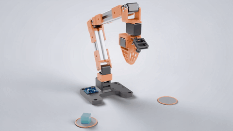](media/5dof_pick_place_render.mp4) | [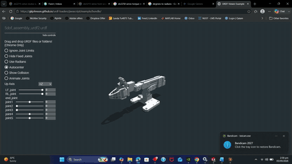](media/5dof_urdf_test.mp4) | [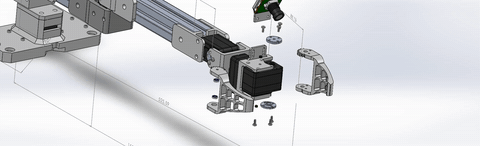](media/5dof_gripper_assembly.mp4) |

Click a preview to open the full MP4.

---

**Full project files are private.** The STEP assembly, URDF/ROS package and full-length videos are in a private repository. Access is available upon request: see [Request access](../README.md#request-access).

[Back to the portfolio](../README.md)
