# 3-DOF SCARA Robotic Manipulator (Servo Driven)

A desktop SCARA arm designed in SolidWorks and 3D printed. Two servo-driven revolute joints move a parallel-rod arm in the horizontal plane. A rack-and-pinion stage gives the vertical axis. The column is a carbon-fibre tube on 608 bearings, and an Arduino Uno in the base enclosure drives the servos. Swappable tools include a claw gripper, a vacuum cup box and a pen holder.

  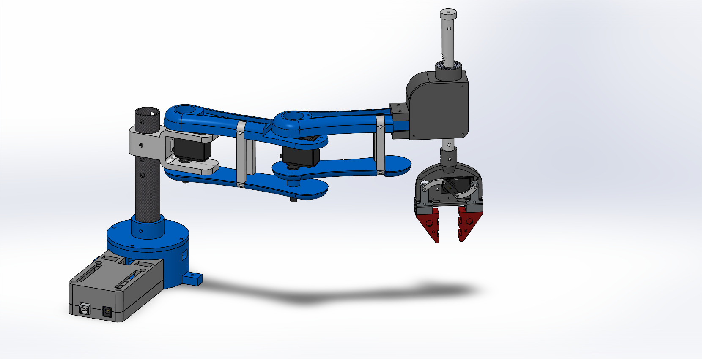
  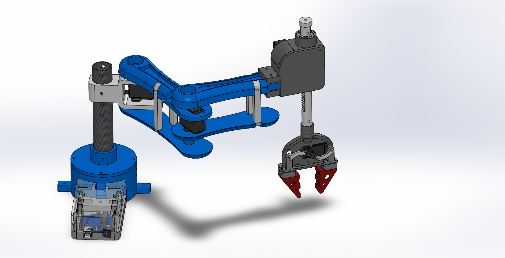

  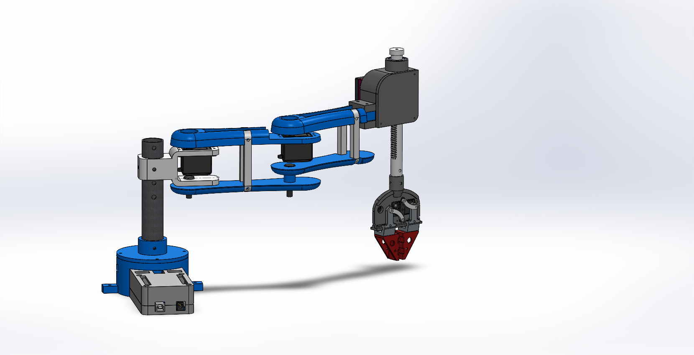
  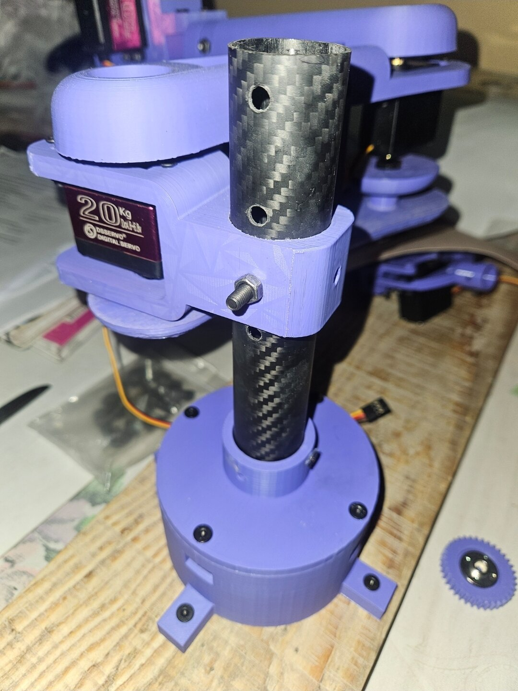

## Highlights

| Item | Detail |
|---|---|
| Configuration | SCARA: 2 revolute (shoulder, elbow) + 1 prismatic (Z) |
| Actuators | DS3218 and MG996R servos |
| Z axis | Rack and spur-gear pinion with rack cap |
| Structure | Carbon-fibre tube column, parallel connecting rods, 608 and linear bearings |
| Controller | Arduino Uno in a printed base enclosure |
| End effectors | Claw gripper with slider, vacuum box, pen holder |
| Validation | SolidWorks Simulation static study of the link1 motor bracket |
| Manufacturing | All structural parts 3D printed (STL files included) |

## Hardware

[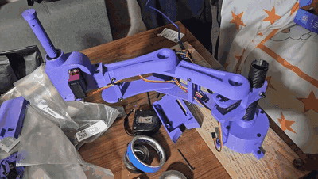](media/scara_hardware.mp4)

Printed and assembled prototype. Click the preview for the full MP4.

## SolidWorks model

  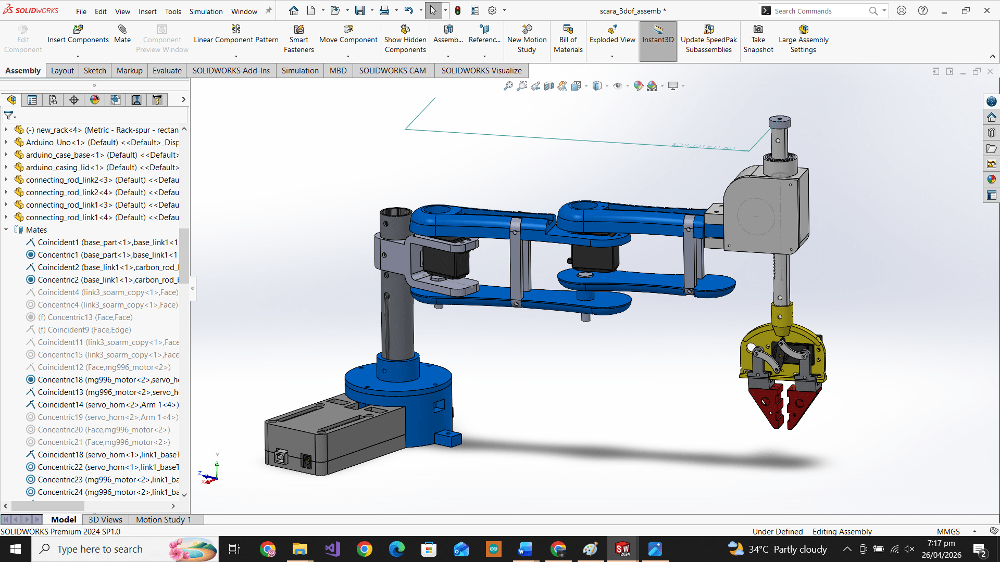
  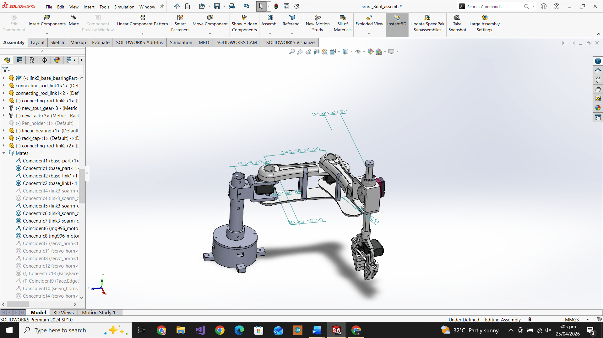

  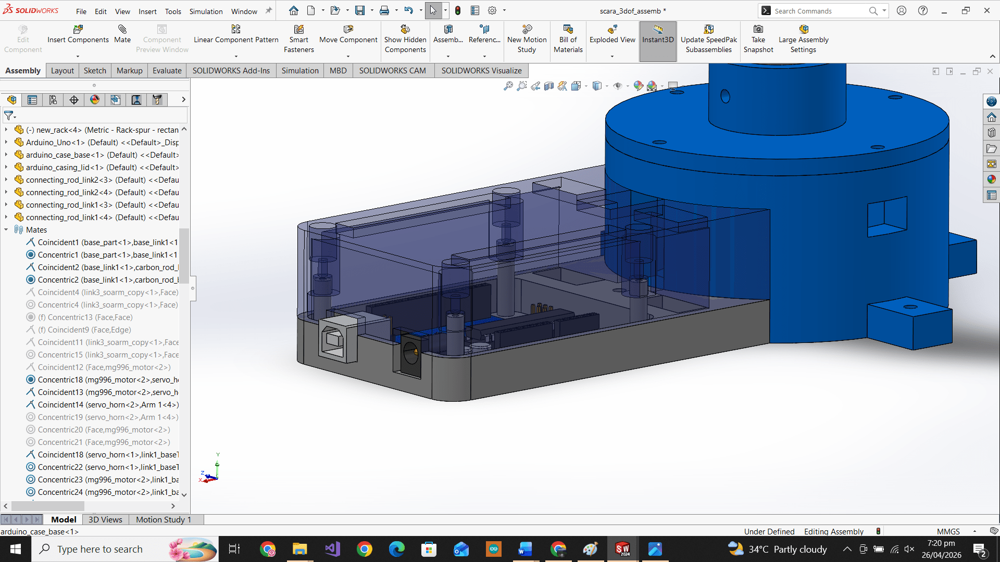
  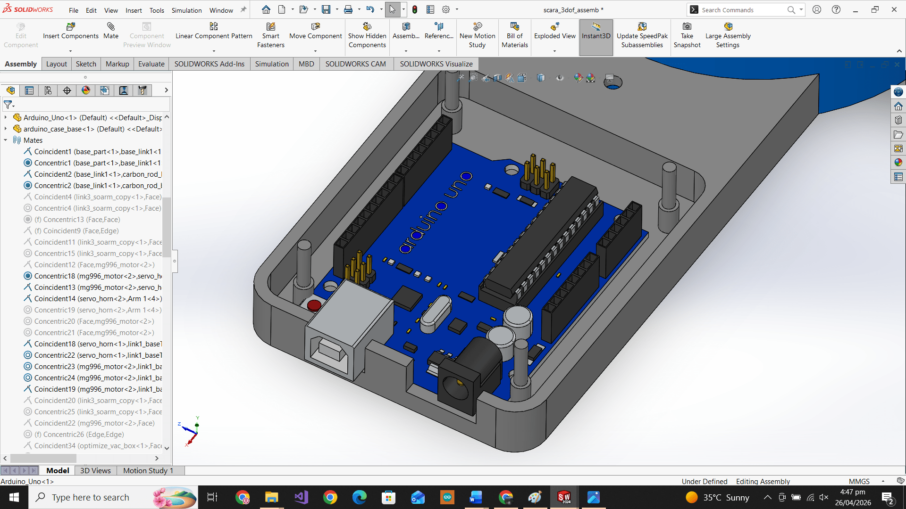
  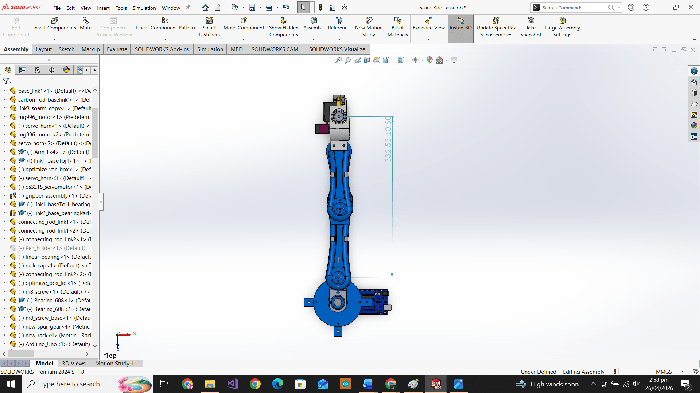

## Fastener callouts

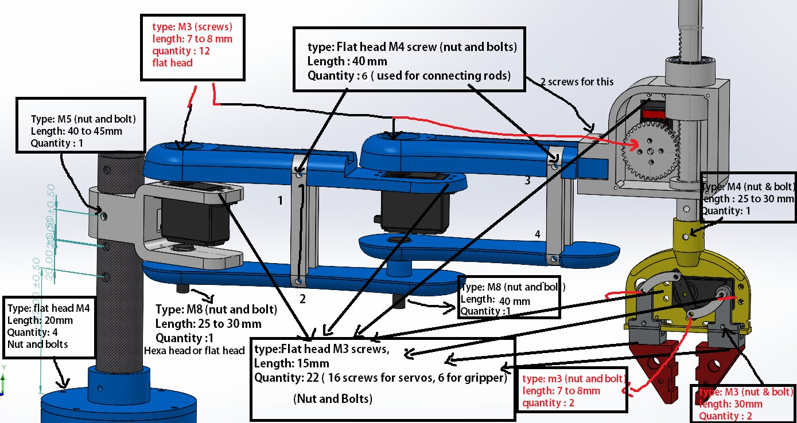

Every joint has its screw type, length and quantity marked (M3, M4, M5, M8).

---

**Full project files are private.** The native SolidWorks files, STEP assembly, print-ready STL files and FEA study are in a private repository. Access is available upon request: see [Request access](../README.md#request-access).

[Back to the portfolio](../README.md)
