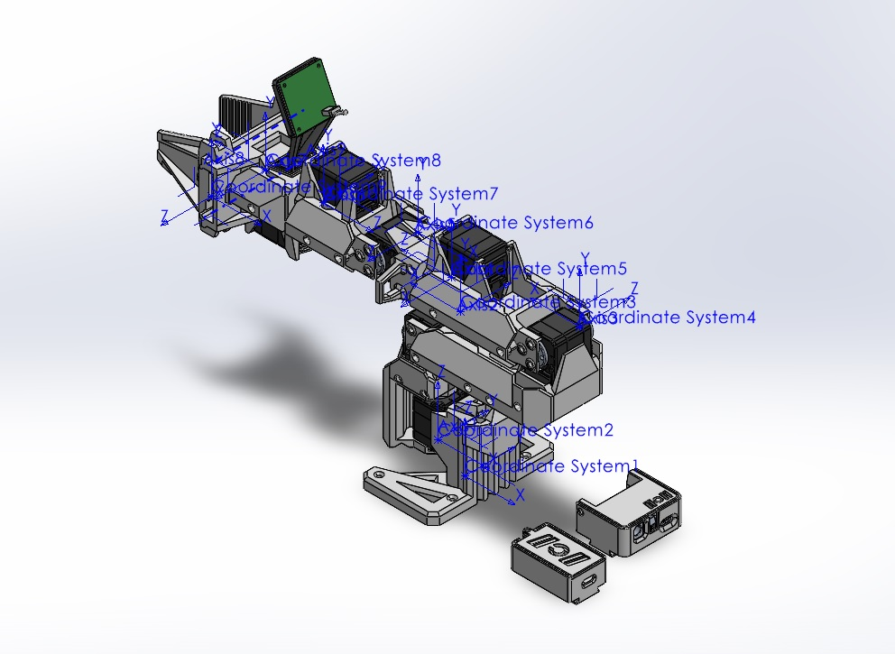
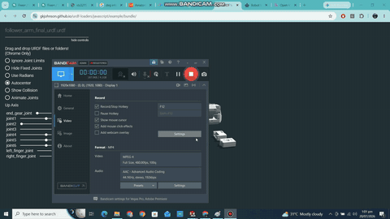

# SO-ARM 101 Modified: SolidWorks Model and URDF Generation

A modified version of the open-source SO-ARM 101 follower arm, remodelled in SolidWorks and exported to a **URDF / ROS description package**. The work covers placing link coordinate frames and joint axes, setting joint limits, and checking the exported model in a URDF viewer. This project came before the [SO-ARM 5-DOF Modified](../SO_ARM_5DOF_Modified) extrusion-link redesign.

  

## Highlights

| Item | Detail |
|---|---|
| Base design | SO-ARM 101 follower arm, modified |
| Joints | 6 revolute + gripper (gear joint and two prismatic fingers) |
| Extras | Camera mount, controller box and covers |
| Model mass (URDF) | approx. 2.1 kg |
| CAD | SolidWorks parts and assembly, full STEP export |
| URDF | SolidWorks to URDF exporter; RViz and Gazebo launch files |

## Video

The exported URDF in a web viewer, with each joint driven through its range. Click the preview for the full MP4.

---

**Full project files are private.** The native SolidWorks files, STEP assembly, URDF/ROS package and kinematic parameters are in a private repository. Access is available upon request: see [Request access](../README.md#request-access).

[Back to the portfolio](../README.md)
