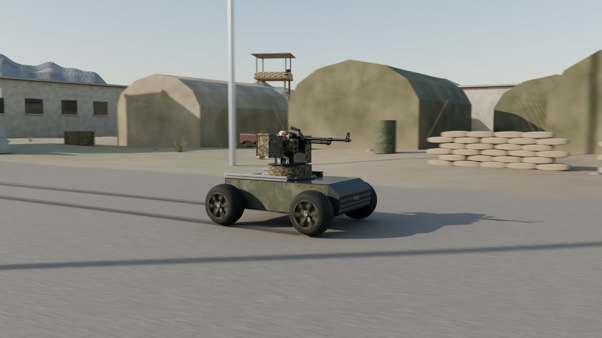
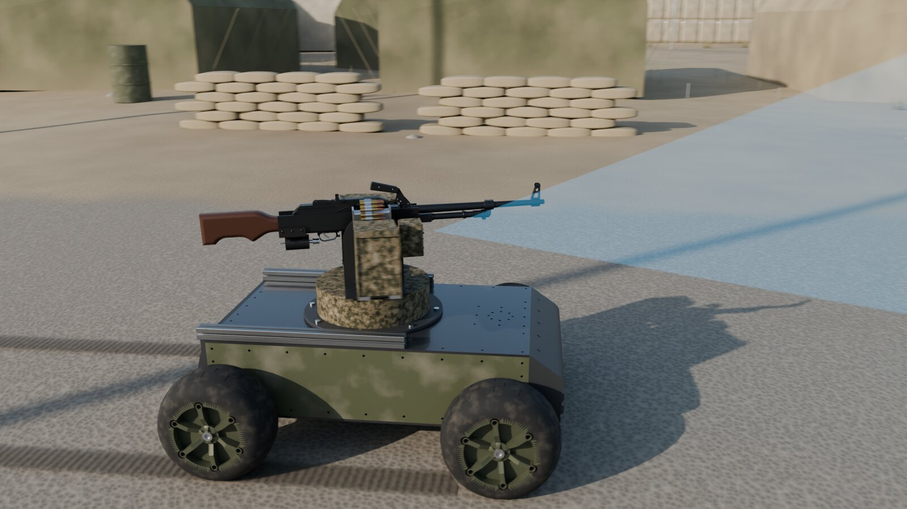
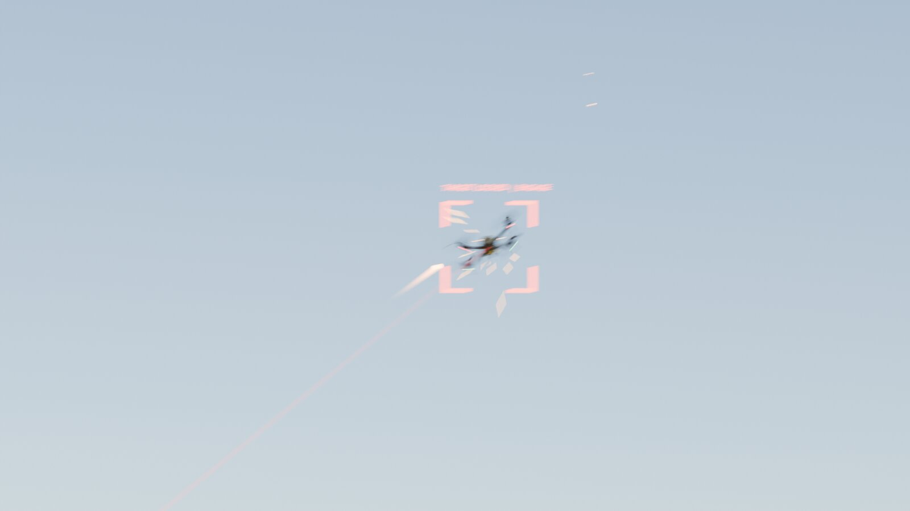
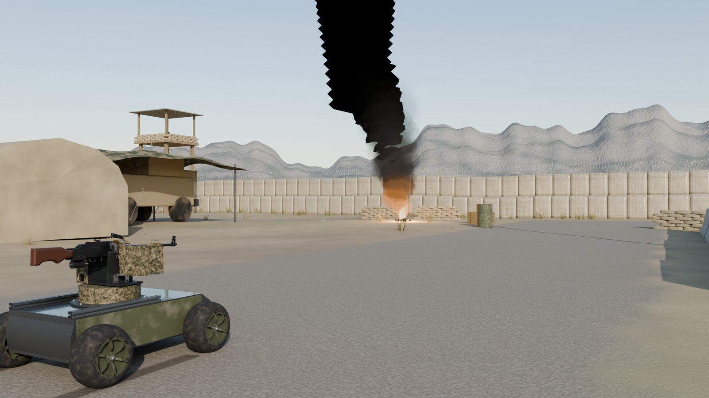
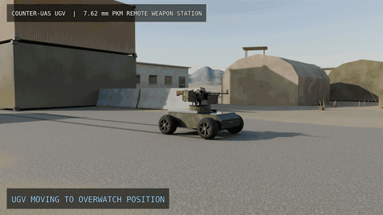

# UGV with Two-Axis Turret Mount (PKM platform)

A four-wheel unmanned ground vehicle (UGV) that carries my [two-axis PKM turret mount](../PKM_Turret_Mount) design. The project integrates the pan/tilt mount, its camera and sensor housing, and the vehicle into one system, and shows it in a rendered concept animation of a counter-drone scenario.

  
  

  
  

## Animation

The UGV patrols a base, the camera picks up an aerial drone, and the pan/tilt mount tracks it. Click the preview for the full MP4.

## Design

| Item | Detail |
|---|---|
| Vehicle | Four-wheel UGV chassis with an armoured body |
| Payload | Two-axis (pan/tilt) turret mount from the PKM mount project |
| Sensing | Camera and laser-sensor housing on the mount |
| Scenario | Base patrol and counter-drone tracking |
| Tools | SolidWorks (design), rendering and animation |

## Process

1. Adapted the PKM turret mount to the vehicle deck and checked its clearance and mounting points.
2. Modelled the UGV chassis, wheels and body around the mount.
3. Placed the camera and sensor housing so the mount can track targets above the vehicle.
4. Rendered stills and a concept animation of the full scenario.

---

**Full project files are private.** The CAD files and the full-resolution animation are in a private repository. Access is available upon request: see [Request access](../README.md#request-access).

[Back to the portfolio](../README.md)
